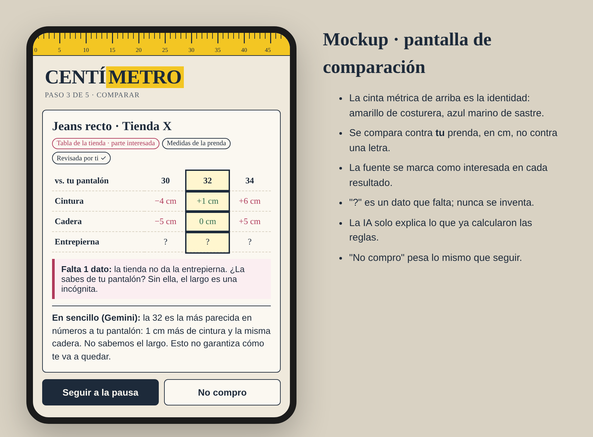
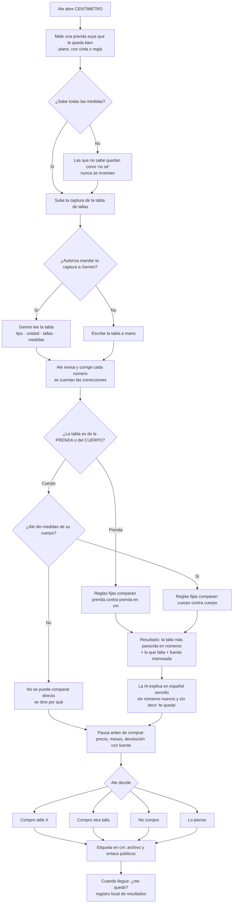
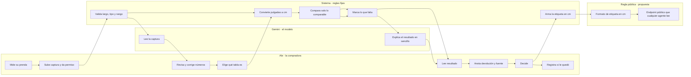

# PACKET: CENTÍMETRO

*Semana 10 de AI 2041, capítulo 9 ("Isle of Happiness"). Rol: ADVERSARY. Nicolás Flores.*
*Este paquete se escribió antes del código. Lo que cambió durante la construcción está al final, en "Cambios después del packet".*

---

## 1. El problema, con mis palabras

Cuando compras ropa en línea en México, la única información de talla que tienes es una letra (S, M, L) o un número, y una tabla que hizo la tienda. Esa letra no significa lo mismo en dos marcas, y a veces ni siquiera en la misma marca. Profeco midió jeans en 2026: **9 de 30 modelos de hombre** medían más de lo que decía su etiqueta, y **3 de 23 modelos de mujer** salieron una talla más chicos.

La ley no ayuda. La NOM-004-SE-2021 obliga a poner la talla en la etiqueta, pero acepta "las abreviaturas que tradicionalmente se vienen utilizando". No dice cuánto mide una M. A una toalla sí le exige centímetros; a tu pantalón, solo una letra.

Las herramientas que resuelven esto ya existen (True Fit, Fit Analytics), pero las pagan las tiendas y viven dentro de la página de la tienda. El dato de cuánto mide la prenda es del vendedor. Esa es la tesis que defendí en la pelea: **el problema no es la interfaz, es de quién es el dato.**

## 2. Usuario exacto

**Ale, 29 años, CDMX.** Compra ropa en línea desde el celular, casi siempre jeans y playeras, en tiendas distintas. Ha devuelto pedidos por talla y una vez se quedó con un pantalón chico porque devolverlo costaba el envío. No tiene cinta métrica a la mano, pero sí tiene **un pantalón que le queda perfecto**. No quiere una app que le diga qué comprar; quiere dejar de adivinar.

## 3. Definición de éxito

> **Antes de que cierre el módulo:** Ale sube la captura de una tabla de tallas, revisa y confirma los números que leyó la IA, los compara en centímetros contra una prenda suya, ve qué falta, decide (incluso "no compro") y se lleva una etiqueta en cm que cualquier persona o agente puede leer. Todo esto sin cuenta y sin que el servidor guarde nada suyo.

Éxito **no** es que Ale compre, ni que obedezca, ni que pase más tiempo en la app. Éxito es una decisión más clara con los datos a la vista.

## 4. Mockup

*Mockup generado antes del código: pantalla de comparación en el celular.*

## 5. Flujo

### Diagrama de flujo

### Carriles: quién hace qué

Nadie más tiene carril. **No hay tienda ni patrocinador en el diagrama**, y no es por olvido.

## 6. Benchmark

- **La mejor solución que existe:** True Fit. Tiene casi 20 años de datos de compras y devoluciones, cientos de millones de perfiles y más de 91 mil marcas. En febrero de 2026 lanzó un agente de tallas y lo abrió por MCP.
- **En qué difiere la mía:** CENTÍMETRO es del comprador. No lo paga una tienda, compara centímetros que tú puedes revisar (no un modelo cerrado) y deja una etiqueta pública en cm que no pertenece a nadie. Además está hecha para México, donde la etiqueta solo trae una letra.

## 7. A largo plazo (3 años)

Si esto funciona, CENTÍMETRO deja de ser una app y se vuelve un formato: la "etiqueta en cm" que cualquier tienda, marca o agente puede leer, igual que el número de serie de un producto. La versión completa sería una propuesta concreta para la NOM-004 (2 o 3 medidas de la prenda en cm, en la etiqueta y en la ficha en línea, legibles por máquina), con datos de compradores que muestren cuánto se equivocan las tablas actuales. La app solo existiría para que la regla tenga evidencia y para que el comprador tenga sus propias medidas, no las de la tienda.

## 8. Lo que NO se construye (scope cut)

- **No es tienda ni recomendador para vendedores** (zona prohibida). No hay enlaces para comprar, ni afiliados, ni "dónde comprarlo".
- No promete que la ropa te quede. Dice qué talla se parece más en números y qué falta.
- No mide tu cuerpo con la cámara ni con IA.
- No hay cuentas, base de datos ni datos personales en el servidor.
- No hay notificaciones, rachas ni puntajes de "felicidad".
- No hay escala a usuarios reales: el piloto de 10 personas del Operator es un paso siguiente, no esta rebanada.
- La regla es una **propuesta**, no una norma vigente. La app nunca dice que la NOM ya cambió.

## 9. Condiciones del Blueprint del equipo y cómo se cumplen

| Condición (video de fusión) | De quién | Cómo la cumple CENTÍMETRO |
|---|---|---|
| El sistema explica la evidencia y la persona conserva la autoridad | Equipo | La app nunca decide. Siempre se puede seguir, y "No compro" es una opción igual de visible que las demás |
| El usuario confirma los datos | Fátima | La tabla que lee la IA no se usa hasta que Ale marca que la revisó contra la captura |
| Lo desconocido queda desconocido; un dato faltante genera una pregunta | Fátima | "No sé" es un valor real. El resultado lista lo que falta y pregunta por ello |
| Las reglas fijas calculan y el modelo solo explica | Fátima | La comparación es código determinista. Gemini recibe el resultado ya calculado y se rechaza su texto si trae números nuevos o promete ajuste |
| Ningún patrocinador ve los datos | Rafael | Las medidas viven solo en el navegador; el servidor no guarda nada |
| Seguir de todos modos; éxito ≠ obediencia ni más tiempo en la app | Operator | No hay bloqueo, no hay métricas de uso y la pausa se puede saltar |
| Los términos de devolución van separados y con fuente | Operator | Es un bloque aparte, con texto, de dónde salió y fecha, o "no la encontré" |
| Mensaje de incertidumbre visible y un responsable | Operator | Cada resultado dice que la tabla es de una parte interesada. Responsable: Nicolás, con reporte en GitHub Issues |
| Registrar errores de extracción | Operator | La app cuenta cuántos números leyó la IA y cuántos corrigió Ale |
| Un consejo neutral puede recomendar no comprar | Rodrigo | "No compro" es un resultado válido y se cuenta igual |
| Desconfiar de fuentes interesadas; condición real para parar | Nicolás | La fuente de cada tabla se etiqueta y la condición para parar está en la sección 12 |
| Sin garantizar el ajuste | Nicolás | Las palabras "te queda", "perfecto" y "garantizado" están prohibidas en el texto de la IA |
| Las tasas de devolución por sí solas no prueban malas decisiones | Equipo | La app no usa el 75.8% ni ningún dato de devoluciones de fuentes sin método |

**Cláusula de sombra (capítulo 9):** el peligro del capítulo es una IA que optimiza tu felicidad por ti y te empuja sin que lo notes. Aquí, la decisión de diseño es que **el freno está dentro del flujo, pero la decisión es tuya.** La comparación aparece antes de decidir, pero nunca bloquea. No hay recomendaciones de compra ni empujones, y la app no gana nada si compras.

## 10. Arquitectura y stack

| Pieza | Qué | Por qué |
|---|---|---|
| Next.js 16 (App Router) + React 19 + TypeScript | Interfaz y rutas de API | Gratis en Vercel, lo mismo que la semana pasada |
| Gemini (capa gratis), solo desde el servidor | Visión: leer la captura de la tabla. Texto: explicar el resultado | Es el LLM + visión del Dragon Stack |
| Medidas de la prenda del usuario | Dato de restricción del usuario | Es el "user-constraint data" del Dragon Stack |
| `src/lib/motor.ts` | Reglas: validación, conversión, comparación, filtro del texto de la IA | Es determinista y tiene autoprueba |
| `localStorage` con try/catch | Prenda, cuerpo, decisiones | No hay datos personales en el servidor, así que no hace falta login |
| `/api/etiquetas` y `/api/esquema` | Datos públicos de ejemplo (ILUSTRATIVO) y el formato | Es el prototipo de regla: cualquier agente lo puede leer |
| Vercel | Deploy desde GitHub | Gratis |

**Seguridad (piso):** no hay llaves en el repo (`GEMINI_API_KEY` vive en Vercel). No se guardan datos personales, así que no se necesita auth ni RLS. Todos los campos tienen límites de largo, tipo y rango, y el servidor los vuelve a validar. La imagen pesa máximo ~1.5 MB, se manda solo con permiso y no se guarda. Hay un límite de solicitudes por IP. Los ejemplos son inventados y están etiquetados.

## 11. Plan de pruebas

**Pase mecánico**
1. Autoprueba del motor (`npx tsx src/lib/__selftest.ts`): conversión de pulgadas, rangos, tolerancias, "no sé", tabla de cuerpo contra prenda, filtro del texto de la IA.
2. Flujo completo con el ejemplo inventado, en celular (390 px) y en escritorio.
3. Una tabla en pulgadas se convierte bien.
4. Una tabla de CUERPO contra una referencia de PRENDA no se compara.
5. Con menos de 2 medidas comparables, no sale ninguna "talla más parecida".
6. Sin permiso de IA, la imagen no sale del navegador (se revisa la red).
7. Una entrada fuera de rango (cintura de 900 cm, texto de 5,000 caracteres) se rechaza en el cliente y en el servidor.
8. Con Gemini real, se lee una captura de una tabla inventada y se anota cuántos números se tuvieron que corregir.
9. `/api/etiquetas` responde JSON válido contra `/api/esquema`.

**Persona test:** dos usuarias sintéticas (sección aparte, `docs/PERSONA.md`).

## 12. Condición para parar

Paro o cambio el enfoque si en las pruebas pasa una de estas tres cosas:
- La lectura de la IA necesita corregir **más de 1 de cada 4 números**. Eso significaría que leer la captura cuesta más de lo que ahorra.
- La mayoría de las tablas reales que pruebe son de **cuerpo y no de prenda**. En ese caso la comparación prenda contra prenda casi nunca aplica, y lo único que queda es la regla.
- La persona del test no entiende **qué medir** sin ayuda.

Si pasa la segunda, no es un fracaso de la tesis: es evidencia para la regla.

---

## Cambios después del packet

- **El permiso de IA se pide al momento de leer la foto**, no con una casilla al inicio (persona test, ronda 1).
- **"Pausa" ahora se llama "Antes de pagar"** y la política de devolución quedó como opcional (persona test).
- **El camino a mano empieza con 2 tallas**, no con la tabla completa (persona test, ronda 2).
- **Se agregó un aviso** cuando una cintura o cadera parece venir "de lado a lado". El packet no lo tenía y salió de la prueba con Doña Lupe.
- "Entrepierna" ahora se llama "Largo interior" en la interfaz. El formato de la etiqueta sigue usando la clave `entrepierna`.
